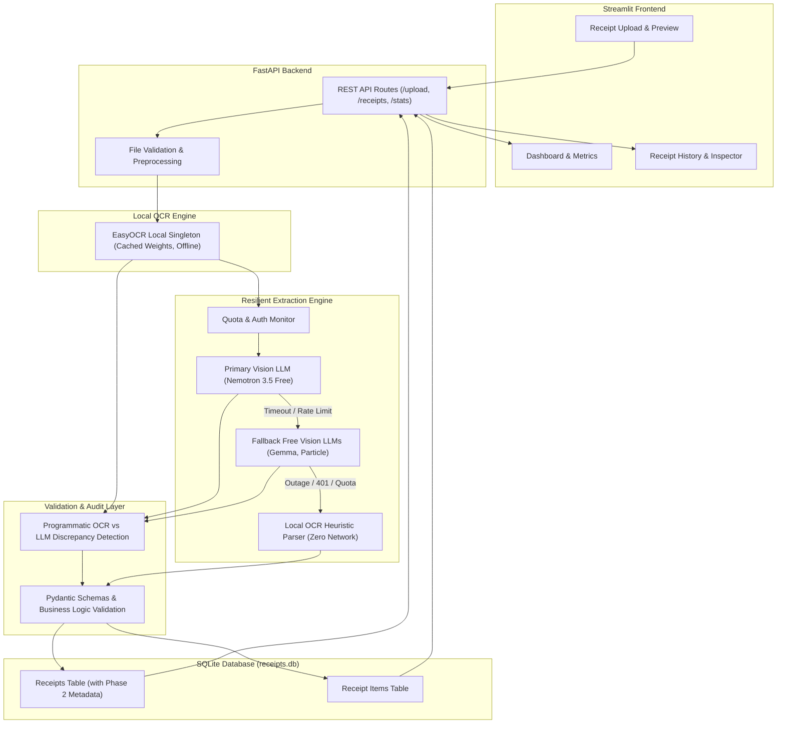
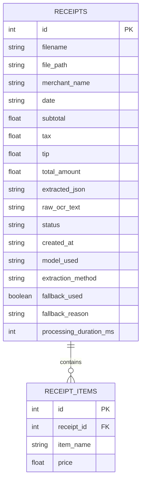

# 🧾 Expense Dispatcher Agent System

**Part 1: AI-Powered Receipt Extraction System (Phase 1, Phase 2 & Phase 2.1 Complete)**

An end-to-end receipt extraction application that ingests receipt images and PDFs, processes them via local OCR (EasyOCR) and a Vision Large Language Model (OpenRouter), cross-checks values using programmatic discrepancy detection, validates the extracted data using strict Pydantic schemas and business logic rules, stores the structured records in a local SQLite database, and presents actionable insights through a Streamlit dashboard.

Phase 2 and Phase 2.1 introduce **performance optimizations, persistent model caching, proactive quota monitoring, multi-model free Vision LLM fallback, zero-network local OCR fallback, programmatic OCR vs. LLM monetary discrepancy detection, and date validation integrity** to guarantee resilient zero-cost extraction under all network and API conditions.

> **Note on Architecture Roadmap**: This repository represents **Part 1 (Receipt Extraction System)** of the overall Expense Dispatcher Agent System. Part 2 will introduce an autonomous Multi-Agent Expense Dispatcher (Expense Agent, Summary Agent, Excel Recipient Reader, and Email Dispatcher) without requiring structural changes to this foundational pipeline.

---

## ✨ Features

### Phase 1 Core Pipeline
- **Multi-Format Receipt Ingestion**: Accepts receipt images (`PNG`, `JPG`, `JPEG`) and documents (`PDF`).
- **File Validation & Preprocessing**: Performs MIME verification, file size checks (up to 10 MB), PDF page bounds (up to 5 pages), integrity validation, EXIF orientation correction, RGB conversion, and high-DPI PDF page rasterization.
- **EasyOCR Local Text Extraction**: Offline OCR text detection and recognition running locally via a singleton reader pattern, eliminating unnecessary network dependencies.
- **OpenRouter Vision LLM Integration**: Leverages Vision LLMs on OpenRouter with base64-encoded receipt imagery and OCR text for accurate structured understanding.
- **Hybrid OCR + Vision Extraction**: Cross-references local OCR text against visual receipt features to extract merchant name, transaction date, line items, subtotal, tax, tip, and total.
- **Self-Healing LLM Retry Pipeline**: If initial JSON parsing or Pydantic validation fails, the service retries the model with validation feedback before setting status to `REVIEW_REQUIRED`.
- **Pydantic Schema & Business Validation**: Cleans monetary characters (`$`, `€`, `£`, commas), normalizes dates to ISO `YYYY-MM-DD`, validates mathematical consistency (`subtotal + tax + tip ≈ total`), and flags negative prices or line item discrepancies.
- **Relational SQLite Persistence**: Stores structured queryable attributes, full raw OCR text, and complete extracted JSON payloads in `receipts`, with separate normalized records in `receipt_items`.
- **Streamlit Frontend Dashboard**: Real-time KPI summary (Total Receipts, Total Expenses, Successful Extractions, Review Required), drag-and-drop receipt processor with synchronous feedback, line item tables, and a full history explorer.
- **Robust Error Handling**: Structured exception hierarchies with sanitized user-facing error messages and controlled exponential backoff for API rate limits.

### Phase 2 Reliability & Performance Enhancements
- **Persistent Local EasyOCR Caching**: Pre-download utility (`setup_models.py`) caches detection (`CRAFT`) and recognition weights in project-relative `models/easyocr/` with `download_enabled=False`, reducing cold reader initialization from ~5 minutes to ~2.5 seconds.
- **Offline Runtime OCR**: EasyOCR executes 100% offline without attempting any network downloads during application runtime.
- **Multi-Model Free Vision Fallback Engine**: Configurable sequential failover chain across verified zero-cost multimodal models (`nvidia/nemotron-3.5-super-vl:free` → `google/gemma-4-31b-it:free` → `particle-ai/particle-1:free`) when the primary model encounters rate limits, timeouts (90s threshold), or availability drops.
- **Strict Zero-Cost Guardrails (`ALLOW_PAID_MODELS=false`)**: Automatic programmatic validation rejects any model ID not ending in `:free`, guaranteeing zero unexpected API charges.
- **Proactive OpenRouter Quota Monitoring**: Background service queries `GET /api/v1/key` with TTL caching (default 60s) to detect free-tier exhaustion before initiating network inference.
- **Zero-Network Local OCR Heuristic Fallback**: Deterministic regex-based parser extracts merchant name, ISO dates, subtotal, tax, tip, total, and line items directly from EasyOCR text when all cloud models are unavailable or unconfigured.
- **Database Schema Migration & Observability**: Seamless non-destructive SQLite migration adds `model_used`, `extraction_method` (`AI` vs `LOCAL_OCR`), `fallback_used`, `fallback_reason`, and `processing_duration_ms` to every receipt record.
- **Frontend Observability Badges**: Visual indicators in the Streamlit UI display extraction method (`AI` vs `LOCAL_OCR`), model ID, fallback status, and end-to-end execution latency in milliseconds.

### Phase 2.1 Discrepancy Detection & Date Integrity
- **Receipt Date Extraction Without Past/Future Judgment**: Prompt explicitly bounds the LLM to extract dates exactly as printed without judging whether they are in the past or future, eliminating false warnings on valid receipts.
- **Strict Date Validation**: Missing, unparseable, or impossible calendar dates (e.g. `2026-02-31`) strictly enforce `REVIEW_REQUIRED` without fabricating dates. Textual dates (`Feb 20, 2026`) normalize cleanly to ISO `2026-02-20`.
- **Programmatic OCR vs. LLM Discrepancy Detection**: Modular service (`discrepancy_service.py`) independently compares confident monetary fields from OCR against LLM structured outputs with a $0.05 tolerance.
- **Automatic Manual Review on Discrepancies**: Confirmed monetary differences on critical fields (Total, Subtotal, Tax, Tip, Line Items) flag descriptive warnings and assign `REVIEW_REQUIRED`.
- **Conservative Discrepancy Matching**: Prevents false alarms on noisy OCR, missing optional fields, or formatting variations (currency symbols, commas) while requiring zero additional AI API calls.

---

## 🏗️ System Architecture



---

## 🛠️ Technology Stack

| Layer | Technology | Purpose |
|---|---|---|
| **Frontend** | Streamlit (1.41.1) | Interactive dashboard, metrics visualization, and receipt upload UI |
| **Backend** | FastAPI (0.115.6) & Uvicorn (0.34.0) | High-performance asynchronous REST API server |
| **API Client** | HTTPX (0.28.1) | Resilient HTTP communications between frontend and backend (300s timeout) |
| **Local OCR** | EasyOCR (1.7.2) & PyTorch (2.15.0) | Offline optical character recognition with locally cached models |
| **Primary AI Inference** | `nvidia/nemotron-3.5-super-vl:free` | Multimodal Vision LLM reasoning on receipt imagery and OCR text |
| **Fallback AI Inference** | `google/gemma-4-31b-it:free`, `particle-ai/particle-1:free` | Zero-cost secondary Vision LLMs for automatic failover |
| **Local Fallback Parser** | Python Regex & Heuristics | Zero-network deterministic extraction directly from OCR text |
| **Discrepancy Detection** | Python Decimal & Regex | Programmatic monetary cross-validation between OCR and LLM outputs |
| **Image Processing** | Pillow (11.1.0) | EXIF orientation normalization, resizing, and format conversion |
| **PDF Processing** | PyMuPDF (1.25.3) | Vector PDF text extraction and high-DPI page rendering |
| **Validation** | Pydantic (2.10.5) | Schema enforcement, date normalization, and business rule validation |
| **Database** | SQLite 3 | Embedded zero-configuration local relational database |
| **ORM** | SQLAlchemy (2.0.37) | Relational modeling, schema migration, and transactional CRUD layer |
| **Configuration** | python-dotenv (1.0.1) | Centralized 12-factor environment variable management |
| **Testing** | Pytest (8.3.4) & pytest-asyncio | Comprehensive testing suite with 99 passing automated tests |

---

## 📁 Project Structure

```text
Expense-Dispatcher-Agent-System/
│
├── frontend/
│   ├── __init__.py
│   ├── app.py                          # Streamlit application entry point
│   ├── api_client.py                   # HTTPX API client connecting to FastAPI (300s timeout)
│   └── components/
│       ├── __init__.py
│       ├── upload.py                   # Upload widget and file preview component
│       ├── receipt_display.py          # Results display, line items, warnings, metadata badges
│       └── receipt_history.py          # Historical receipts viewer, search, and latency inspector
│
├── backend/
│   ├── __init__.py
│   ├── main.py                         # FastAPI application initialization & lifespan
│   ├── api/
│   │   ├── __init__.py
│   │   └── receipt_routes.py           # REST API endpoints (/upload, /receipts, /stats)
│   ├── services/
│   │   ├── __init__.py
│   │   ├── file_service.py             # File validation, MIME checks, unique disk storage
│   │   ├── preprocessing_service.py    # Pillow image normalization & PyMuPDF page rendering
│   │   ├── ocr_service.py              # EasyOCR local singleton with project model caching
│   │   ├── llm_service.py              # OpenRouter Vision API integration, timeout, and backoff
│   │   ├── quota_service.py            # OpenRouter key quota monitor with TTL caching (Phase 2)
│   │   ├── model_fallback_service.py   # Multi-model AI fallback & local OCR coordinator (Phase 2)
│   │   ├── local_receipt_parser.py     # Zero-network heuristic OCR text parser (Phase 2)
│   │   ├── discrepancy_service.py      # Programmatic OCR vs LLM discrepancy detector (Phase 2.1)
│   │   ├── extraction_service.py       # Full extraction pipeline orchestrator with latency tracking
│   │   └── validation_service.py       # Business logic validation & status determination (Phase 2.1)
│   ├── database/
│   │   ├── __init__.py
│   │   ├── connection.py               # SQLAlchemy engine, session maker, non-destructive migration
│   │   ├── models.py                   # ORM models (Receipt, ReceiptItem) with Phase 2 columns
│   │   └── repository.py               # Data access layer (CRUD, metadata persistence, stats)
│   ├── schemas/
│   │   ├── __init__.py
│   │   └── receipt_schema.py           # Pydantic schemas, date normalizer, Phase 2 metadata
│   ├── utils/
│   │   ├── __init__.py
│   │   ├── config.py                   # Centralized configuration with fallback model lists
│   │   ├── logger.py                   # Standardized logging configuration
│   │   └── exceptions.py               # Structured application domain exceptions
│   └── uploads/                        # Uploaded receipts storage (gitignored)
│       └── .gitkeep
│
├── models/
│   └── easyocr/                        # Pre-cached EasyOCR weights (craft, english) (gitignored)
│
├── tests/
│   ├── __init__.py
│   ├── test_api.py                     # API route & HTTP exception tests (9 tests)
│   ├── test_database.py                # Database CRUD, migration, and metadata tests (14 tests)
│   ├── test_date_handling.py           # Date extraction, normalization & status tests (12 tests, Phase 2.1)
│   ├── test_discrepancy.py             # OCR vs LLM monetary discrepancy tests (10 tests, Phase 2.1)
│   ├── test_extraction.py              # OCR & LLM parsing/retry unit tests (10 tests)
│   ├── test_fallback.py                # Multi-model fallback coordinator tests (4 tests)
│   ├── test_local_parser.py            # Local heuristic OCR text parser tests (10 tests)
│   ├── test_model_setup.py             # EasyOCR model caching and setup tests (4 tests)
│   ├── test_quota.py                   # Quota monitoring & TTL caching tests (5 tests)
│   └── test_validation.py              # Pydantic schema & business rule tests (21 tests)
│
├── Receipts/                           # Demonstration receipt images
│   ├── Receipt 1.png                   # Original receipt: The Corner Bistro
│   ├── Receipt 2.png                   # Original receipt: Target Stores
│   └── Receipt 3.png                   # Original receipt: Quick-Mart Fuel
│
├── Receipt Result/                     # Application extraction screenshots
│   ├── Receipt1.png                    # Live extraction UI result: The Corner Bistro
│   └── Receipt2.png                    # Live extraction UI result: Target Stores
│
├── .env.example                        # Template for environment variables (Phase 2 updated)
├── .gitignore                          # Git exclusion rules
├── pytest.ini                          # Pytest configuration
├── requirements.txt                    # Pinned project dependencies
├── setup_models.py                     # Offline EasyOCR weight preparation script (Phase 2)
├── run.py                              # Unified application launcher (backend + frontend)
└── README.md                           # Project documentation
```

---

## 📷 Receipt Images and Extraction Results

Below are the original receipt inputs alongside their live extraction screenshots produced by the application dashboard.

### Example 1 – The Corner Bistro

| Original Receipt Image | Extracted Result Screenshot |
|:---:|:---:|
|  |  |

---

### Example 2 – Target Stores

| Original Receipt Image | Extracted Result Screenshot |
|:---:|:---:|
|  |  |

---

## 🔍 Verified Live Extraction Results

All test receipts were processed end-to-end through live inference, rigorously validated against business rules, and persisted in SQLite.

### Receipt 1 – THE CORNER BISTRO (Live Verified)

- **Merchant Name**: `THE CORNER BISTRO`
- **Receipt Date**: `2026-02-20`
- **Subtotal**: `$77.50`
- **Tax**: `$6.98`
- **Tip**: `$15.00`
- **Total Amount**: `$99.48`
- **Extracted Line Items**:
  - `Sparkling Water` — `$4.00`
  - `Caesar Salad` — `$22.00`
  - `Grilled Salmon` — `$48.00`
  - `Espresso` — `$3.50`
- **Arithmetic Check**: $77.50 (subtotal) + $6.98 (tax) + $15.00 (tip) = $99.48 (exact match)
- **Extraction Method**: `AI` (`nvidia/nemotron-3.5-super-vl:free`)
- **Fallback Used**: `False`
- **Processing Time**: `16.47s`
- **Status**: `COMPLETED`

---

### Receipt 2 – TARGET STORES (Live Verified)

- **Merchant Name**: `TARGET STORES`
- **Receipt Date**: `2026-02-18`
- **Subtotal**: `$46.48`
- **Tax**: `$3.83`
- **Tip**: *Not specified* (`null` — correctly omitted without fabrication)
- **Total Amount**: `$50.31`
- **Extracted Line Items**:
  - `Wireless Mouse` — `$24.99`
  - `USB-C Cable 6ft` — `$12.50`
  - `Notebook 3-Pack` — `$8.99`
- **Arithmetic Check**: $46.48 (subtotal) + $3.83 (tax) = $50.31 (exact match)
- **Extraction Method**: `AI` (`nvidia/nemotron-3.5-super-vl:free`)
- **Fallback Used**: `False`
- **Status**: `COMPLETED`

---

## 🚀 Installation and Environment Setup

### 1. Clone the Repository

```powershell
git clone https://github.com/Manvendra9830/Expense-Dispatcher-Agent-System.git
cd Expense-Dispatcher-Agent-System
```

### 2. Create and Activate Virtual Environment

**Windows PowerShell:**
```powershell
python -m venv .venv
.\.venv\Scripts\Activate.ps1
```

**Linux / macOS:**
```bash
python3 -m venv .venv
source .venv/bin/activate
```

### 3. Upgrade Pip and Install Dependencies

```powershell
python -m pip install --upgrade pip
python -m pip install -r requirements.txt
```

### 4. Prepare EasyOCR Model Weights (Offline Setup)

Run the model setup script to copy existing cached weights or pre-download them into the local project cache:

```powershell
python setup_models.py
```

> **Important**: EasyOCR weights (`craft_mlt_25k.pth` and `english_g2.pth`) are prepared during this setup step, **not** during normal application runtime. Once prepared, the application initializes EasyOCR in ~2.5 seconds and runs 100% offline without network downloads.

### 5. Configure Environment Variables

Create a local `.env` file by copying the template:

```powershell
copy .env.example .env
```

Edit `.env` with your actual settings (placeholders shown below):

```env
# OpenRouter Free AI API Configuration
OPENROUTER_API_KEY=your_openrouter_api_key_here
OPENROUTER_PRIMARY_MODEL=nvidia/nemotron-3.5-super-vl:free
OPENROUTER_FALLBACK_MODELS=google/gemma-4-31b-it:free,particle-ai/particle-1:free
ALLOW_PAID_MODELS=false
OPENROUTER_BASE_URL=https://openrouter.ai/api/v1
OPENROUTER_TIMEOUT=90.0

# Backward compatibility alias
OPENROUTER_MODEL=nvidia/nemotron-3.5-super-vl:free

# Quota Monitoring
QUOTA_CACHE_TTL_SECONDS=60

# HTTP Communication Timeout
HTTP_REQUEST_TIMEOUT=300.0

# Database Configuration
DATABASE_URL=sqlite:///./receipts.db

# Upload Limits
MAX_UPLOAD_SIZE_MB=10
MAX_PDF_PAGES=5

# OCR Language
OCR_LANGUAGE=en

# Server Configuration
BACKEND_HOST=127.0.0.1
BACKEND_PORT=8000
FRONTEND_PORT=8501
BACKEND_BASE_URL=http://127.0.0.1:8000
```

> **Security Note**: Never commit your `.env` file containing actual API credentials. The `.gitignore` file is configured to keep it excluded.

---

## ▶️ Running the Application

### Option A: Unified Launcher (Recommended)

Starts both the FastAPI backend and Streamlit frontend concurrently:

```powershell
python run.py
```

### Option B: Individual Terminal Startup

**Terminal 1 — FastAPI Backend:**
```powershell
.\.venv\Scripts\Activate.ps1
uvicorn backend.main:app --reload --host 127.0.0.1 --port 8000
```

**Terminal 2 — Streamlit Frontend:**
```powershell
.\.venv\Scripts\Activate.ps1
streamlit run frontend/app.py
```

### Service Access URLs

| Interface | URL |
|---|---|
| **Streamlit Dashboard** | [http://127.0.0.1:8501](http://127.0.0.1:8501) |
| **FastAPI Backend Root** | [http://127.0.0.1:8000](http://127.0.0.1:8000) |
| **Interactive Swagger API Docs** | [http://127.0.0.1:8000/docs](http://127.0.0.1:8000/docs) |
| **Health Check Endpoint** | [http://127.0.0.1:8000/health](http://127.0.0.1:8000/health) |

---

## 📡 API Endpoints

The FastAPI backend exposes the following RESTful routes:

| Method | Endpoint | Description |
|---|---|---|
| `GET` | `/health` | Health check endpoint returning `{ "status": "healthy", "service": "receipt-extractor" }` |
| `POST` | `/upload` | Multipart form endpoint accepting receipt image/PDF; executes OCR + Fallback AI and persists result |
| `GET` | `/receipts` | Lists historical receipts ordered by creation date descending with Phase 2 metadata |
| `GET` | `/receipts/{id}` | Fetches detailed receipt metadata, validation warnings, raw OCR text, latency, and line items |
| `DELETE` | `/receipts/{id}` | Deletes a receipt record and cascade-deletes all associated line items |
| `GET` | `/stats` | Computes dashboard aggregate statistics (total receipts, expenses, success/review counts) |

### Sample Response (`POST /upload` or `GET /receipts/{id}`)

```json
{
  "id": 5,
  "filename": "e727cc16b13d44e7b1de0f16c28b60bd.png",
  "merchant_name": "THE CORNER BISTRO",
  "date": "2026-02-20",
  "line_items": [
    { "item_name": "Sparkling Water", "price": "4.00" },
    { "item_name": "Caesar Salad", "price": "22.00" },
    { "item_name": "Grilled Salmon", "price": "48.00" },
    { "item_name": "Espresso", "price": "3.50" }
  ],
  "subtotal": 77.5,
  "tax": 6.98,
  "tip": 15.0,
  "total_amount": 99.48,
  "status": "COMPLETED",
  "warnings": [],
  "raw_ocr_text": "THE CORNER BISTRO Order #849 Table 12...",
  "created_at": "2026-02-20T14:30:00",
  "model_used": "nvidia/nemotron-3.5-super-vl:free",
  "extraction_method": "AI",
  "fallback_used": false,
  "fallback_reason": null,
  "processing_duration_ms": 16471
}
```

---

## 🗄️ Database Architecture

The application persists data in SQLite via SQLAlchemy ORM models configured with foreign keys, cascade deletion, and automatic non-destructive column migration.



- **Structured Columns**: Enables direct SQL querying and fast aggregations for metrics (`total_expenses`, `merchant_name`, `date`).
- **Complete Extracted JSON**: Stores the full validated payload (`extracted_json`) ensuring zero data loss and forward schema compatibility.
- **Raw OCR Text**: Preserves original extracted text (`raw_ocr_text`) for debugging, auditing, or future re-extraction.
- **Execution Metadata (Phase 2)**: Tracks `model_used`, `extraction_method` (`AI` vs `LOCAL_OCR`), `fallback_used`, `fallback_reason`, and `processing_duration_ms` for production observability.
- **Line Items Relational Table**: Normalizes line items into `receipt_items` linked to the primary receipt key.

---

## 🧪 Testing Suite

Automated testing is configured via Pytest, covering unit validation, OCR response handling, LLM prompt formatting, fallback coordinators, local parsers, quota monitors, discrepancy detection, date normalization, database migrations, and API routes. External LLM and OCR API calls are mocked in tests to guarantee fast, zero-cost, reproducible test execution.

```powershell
python -m pytest -v
```

### Test Progression Across Project Phases

- **Phase 1 Baseline**: 52 tests passing.
- **Phase 2 Implementation**: 77 tests passing (+25 tests for fallback, local parser, quota, model setup).
- **Phase 2.1 Refinements**: **99 tests passing** (+22 tests for discrepancy detection, date extraction, and validation).

### Latest Test Results (99/99 Tests Passing)

```text
tests/test_api.py .........                               [  9 passed ]
tests/test_database.py ..............                     [ 14 passed ]
tests/test_date_handling.py ............                  [ 12 passed ]
tests/test_discrepancy.py ..........                      [ 10 passed ]
tests/test_extraction.py ..........                       [ 10 passed ]
tests/test_fallback.py ....                               [  4 passed ]
tests/test_local_parser.py ..........                     [ 10 passed ]
tests/test_model_setup.py ....                            [  4 passed ]
tests/test_quota.py .....                                 [  5 passed ]
tests/test_validation.py .....................            [ 21 passed ]

======================= 99 passed, 21 warnings in 2.45s =======================
```

- **API Tests (9)**: Verifies `/health`, valid image uploads, invalid MIME rejections, empty file handling, corrupted file detection, empty/populated history retrieval, and 404 responses.
- **Database Tests (14)**: Verifies receipt insertion, nullable fields handling, failed record creation, cascade deletion, schema migration, and metadata column persistence.
- **Date Handling Tests (12, Phase 2.1)**: Verifies exact date extraction without future-date bias, ISO formatting, textual month parsing, missing date handling, and enforcement of `REVIEW_REQUIRED` for invalid/impossible calendar dates.
- **Discrepancy Detection Tests (10, Phase 2.1)**: Verifies matching OCR and LLM totals, discrepancy flagging on totals, subtotals, taxes, tips, and line items, avoidance of false alarms on formatting/ambiguity, and zero extra AI API calls.
- **Extraction Tests (10)**: Verifies LLM response JSON parsing, markdown code-fence stripping, OCR text parsing, auth error handling, and rate limit backoff.
- **Model Setup Tests (4)**: Verifies local model weight existence checks, user cache reuse, and offline execution integrity.
- **Quota Monitoring Tests (5)**: Verifies OpenRouter key validation, free-tier detection, usage limits, and TTL caching.
- **Fallback Coordinator Tests (4)**: Verifies sequential primary-to-fallback transition, 401 fast failure, timeout handling, and automatic failover to local OCR.
- **Local OCR Parser Tests (10)**: Verifies deterministic merchant detection, date formats (ISO, textual, slashed), subtotal/tax/tip/total extraction, and line item parsing without network access.
- **Validation Tests (21)**: Verifies Pydantic schema validation, monetary string sanitization, ISO date conversions, arithmetic consistency checks, negative price flagging, and status determination (`COMPLETED` vs. `REVIEW_REQUIRED`).

---

## 🔮 Future Scope – Part 2: Multi-Agent Expense Dispatcher

The Part 1 architecture has been designed from the ground up to allow seamless integration of Part 2 without altering the existing extraction pipeline:

- **Expense Categorization Agent**: Automatically classifies extracted line items into corporate expense categories (Meals, Travel, Supplies, Software).
- **Summary & Analytics Agent**: Synthesizes periodic executive expense reports, budget trend alerts, and policy compliance summaries.
- **Excel Recipient Reader**: Reads recipient distribution lists and department budget mappings from Excel workbooks.
- **Email Dispatcher**: Connects to SMTP/Gmail services to distribute approved expense summaries and receipt attachments to stakeholders.

> **Status**: Part 1 (including Phase 2 & 2.1 reliability enhancements) is fully implemented and operational. Part 2 multi-agent dispatching remains planned for a future phase.

---

## 📄 License

This project was developed as a technical assessment for an AI Engineer / Full-Stack ML Intern role.
