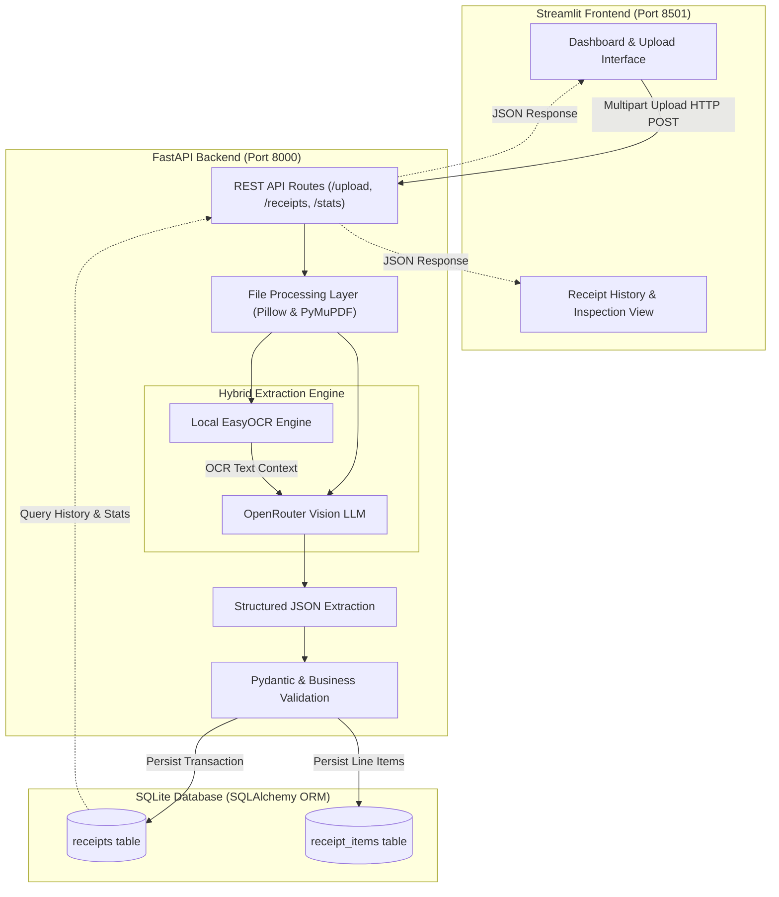
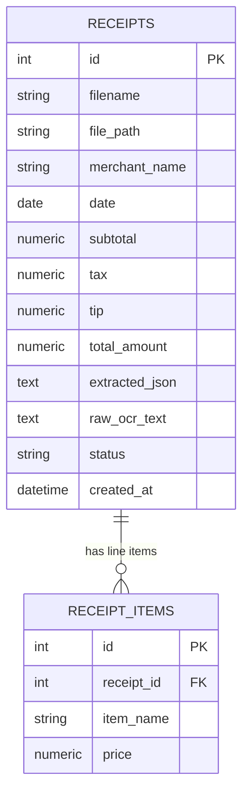

# 🧾 Expense Dispatcher Agent System

**Part 1: AI-Powered Receipt Extraction System**

An end-to-end receipt extraction application that ingests receipt images and PDFs, processes them via local OCR (EasyOCR) and a Vision Large Language Model (OpenRouter), validates the extracted data using strict Pydantic schemas and business logic rules, stores the structured records in a local SQLite database, and presents actionable insights through a Streamlit dashboard.

> **Note on Architecture Roadmap**: This repository represents **Part 1 (Receipt Extraction System)** of the overall Expense Dispatcher Agent System. Part 2 will introduce an autonomous Multi-Agent Expense Dispatcher (Expense Agent, Summary Agent, Excel Recipient Reader, and Email Dispatcher) without requiring major structural changes to this foundational pipeline.

---

## ✨ Features

- **Multi-Format Receipt Ingestion**: Accepts receipt images (`PNG`, `JPG`, `JPEG`) and documents (`PDF`).
- **File Validation & Preprocessing**: Performs MIME verification, file size checks (up to 10 MB), PDF page bounds (up to 5 pages), integrity validation, EXIF orientation correction, RGB conversion, and high-DPI PDF page rasterization.
- **EasyOCR Local Text Extraction**: Offline OCR text detection and recognition running locally via a singleton reader pattern, minimizing unnecessary network traffic.
- **OpenRouter Vision LLM Integration**: Leverages Vision LLMs on OpenRouter with base64-encoded receipt imagery and OCR text for accurate structured understanding.
- **Hybrid OCR + Vision Extraction**: Cross-references local OCR text against visual receipt features to extract merchant name, transaction date, line items, subtotal, tax, tip, and total.
- **Self-Healing LLM Retry Pipeline**: If initial JSON parsing or Pydantic validation fails, the service retries the model with validation feedback before setting status to `REVIEW_REQUIRED`.
- **Pydantic Schema & Business Validation**: Cleans monetary characters (`$`, `€`, `£`, commas), normalizes dates to ISO `YYYY-MM-DD`, validates mathematical consistency (`subtotal + tax + tip ≈ total`), and flags negative prices or line item discrepancies.
- **Relational SQLite Persistence**: Stores structured queryable attributes, full raw OCR text, and complete extracted JSON payloads in `receipts`, with separate normalized records in `receipt_items`.
- **Streamlit Frontend Dashboard**: Real-time KPI summary (Total Receipts, Total Expenses, Successful Extractions, Review Required), drag-and-drop receipt processor with synchronous feedback, line item tables, and a full history explorer.
- **Robust Error Handling**: Structured exception hierarchies with sanitized user-facing error messages and controlled exponential backoff for API rate limits.

---

## 🏗️ System Architecture



---

## 🛠️ Technology Stack

| Layer | Technology | Purpose |
|---|---|---|
| **Frontend** | Streamlit (1.41.1) | Interactive dashboard, metrics visualization, and receipt upload UI |
| **Backend** | FastAPI (0.115.6) & Uvicorn (0.34.0) | High-performance asynchronous REST API server |
| **API Client** | HTTPX (0.28.1) | Resilient HTTP communications between frontend and backend |
| **Local OCR** | EasyOCR (1.7.2) & PyTorch (2.15.0) | Offline optical character recognition for receipts |
| **AI Inference** | OpenRouter Vision LLM API | Multimodal LLM reasoning on receipt imagery and OCR text |
| **Image Processing** | Pillow (11.1.0) | EXIF orientation normalization, resizing, and format conversion |
| **PDF Processing** | PyMuPDF (1.25.3) | Vector PDF text extraction and high-DPI page rendering |
| **Validation** | Pydantic (2.10.5) | Schema enforcement, type coercion, and business rule validation |
| **Database** | SQLite 3 | Embedded zero-configuration local relational database |
| **ORM** | SQLAlchemy (2.0.37) | Relational modeling, migrations, and transactional CRUD layer |
| **Configuration** | python-dotenv (1.0.1) | Centralized 12-factor environment variable management |
| **Testing** | Pytest (8.3.4) & pytest-asyncio | Comprehensive unit, service, integration, and API testing |

---

## 📁 Project Structure

```text
Expense-Dispatcher-Agent-System/
│
├── frontend/
│   ├── __init__.py
│   ├── app.py                          # Streamlit application entry point
│   ├── api_client.py                   # HTTPX API client connecting to FastAPI
│   └── components/
│       ├── __init__.py
│       ├── upload.py                   # Upload widget and file preview component
│       ├── receipt_display.py          # Results display, line item table, warnings
│       └── receipt_history.py          # Historical receipts viewer and detail inspector
│
├── backend/
│   ├── __init__.py
│   ├── main.py                         # FastAPI application initialization & lifespan
│   ├── api/
│   │   ├── __init__.py
│   │   └── receipt_routes.py           # REST API endpoints (/upload, /receipts, /stats)
│   ├── services/
│   │   ├── __init__.py
│   │   ├── file_service.py             # File validation, MIME checks, unique disk storage
│   │   ├── preprocessing_service.py    # Pillow image normalization & PyMuPDF page rendering
│   │   ├── ocr_service.py              # EasyOCR local singleton text extractor
│   │   ├── llm_service.py              # OpenRouter Vision API integration & backoff
│   │   ├── extraction_service.py       # Full extraction pipeline orchestrator with retry
│   │   └── validation_service.py       # Business logic validation & arithmetic consistency
│   ├── database/
│   │   ├── __init__.py
│   │   ├── connection.py               # SQLAlchemy engine, session maker, DB init
│   │   ├── models.py                   # ORM models (Receipt, ReceiptItem)
│   │   └── repository.py               # Data access layer (CRUD and statistics queries)
│   ├── schemas/
│   │   ├── __init__.py
│   │   └── receipt_schema.py           # Pydantic schemas, data sanitizers, response models
│   ├── utils/
│   │   ├── __init__.py
│   │   ├── config.py                   # Centralized configuration loaded from .env
│   │   ├── logger.py                   # Standardized logging configuration
│   │   └── exceptions.py               # Structured application domain exceptions
│   └── uploads/                        # Uploaded receipts storage (gitignored)
│       └── .gitkeep
│
├── tests/
│   ├── __init__.py
│   ├── test_api.py                     # API route & HTTP exception tests (9 tests)
│   ├── test_database.py                # Database CRUD and aggregation tests (12 tests)
│   ├── test_extraction.py              # OCR & LLM parsing/retry unit tests (10 tests)
│   └── test_validation.py              # Pydantic schema & business rule tests (21 tests)
│
├── Receipts/                           # Demonstration receipt images
│   ├── Receipt 1.png                   # Original receipt: The Corner Bistro
│   └── Receipt 2.png                   # Original receipt: Target Stores
│
├── Receipt Result/                     # Application extraction screenshots
│   ├── Receipt1.png                    # Live extraction UI result: The Corner Bistro
│   └── Receipt2.png                    # Live extraction UI result: Target Stores
│
├── .env.example                        # Template for environment variables
├── .gitignore                          # Git exclusion rules
├── pytest.ini                          # Pytest configuration
├── requirements.txt                    # Pinned project dependencies
├── run.py                              # Unified application launcher (backend + frontend)
└── README.md                           # Project documentation
```

---

## 📷 Receipt Images and Extraction Results

Below are the original receipt inputs alongside their live extraction screenshots produced by the application dashboard.

### Example 1 – The Corner Bistro

| Original Receipt Image | Extracted Result Screenshot |
|:---:|:---:|
|  |  |

---

### Example 2 – Target Stores

| Original Receipt Image | Extracted Result Screenshot |
|:---:|:---:|
|  |  |

---

## 🔍 Verified Live Extraction Results

Both receipts were processed end-to-end through live inference, rigorously validated against business rules, and persisted in SQLite.

### Receipt 1 – THE CORNER BISTRO

- **Merchant Name**: `THE CORNER BISTRO`
- **Receipt Date**: `2026-02-20`
- **Subtotal**: `$77.50`
- **Tax**: `$6.98`
- **Tip**: `$15.00`
- **Total Amount**: `$99.48`
- **Extracted Line Items**:
  - `Sparkling Water` — `$4.00`
  - `Caesar Salad` — `$22.00`
  - `Grilled Salmon` — `$48.00`
  - `Espresso` — `$3.50`
- **Arithmetic Check**: $77.50 (subtotal) + $6.98 (tax) + $15.00 (tip) = $99.48 (exact match)
- **Status**: `COMPLETED`

---

### Receipt 2 – TARGET STORES

- **Merchant Name**: `TARGET STORES`
- **Receipt Date**: `2026-02-18`
- **Subtotal**: `$46.48`
- **Tax**: `$3.83`
- **Tip**: *Not specified* (`null`)
- **Total Amount**: `$50.31`
- **Extracted Line Items**:
  - `Wireless Mouse` — `$24.99`
  - `USB-C Cable 6ft` — `$12.50`
  - `Notebook 3-Pack` — `$8.99`
- **Arithmetic Check**: $46.48 (subtotal) + $3.83 (tax) = $50.31 (exact match)
- **Status**: `COMPLETED`

---

## 🚀 Installation and Environment Setup

### 1. Clone the Repository

```powershell
git clone https://github.com/Manvendra9830/Expense-Dispatcher-Agent-System.git
cd Expense-Dispatcher-Agent-System
```

### 2. Create and Activate Virtual Environment

**Windows PowerShell:**
```powershell
python -m venv .venv
.\.venv\Scripts\Activate.ps1
```

**Linux / macOS:**
```bash
python3 -m venv .venv
source .venv/bin/activate
```

### 3. Upgrade Pip and Install Dependencies

```powershell
python -m pip install --upgrade pip
python -m pip install -r requirements.txt
```

### 4. Configure Environment Variables

Create a local `.env` file by copying the template:

```powershell
copy .env.example .env
```

Edit `.env` with your actual settings (placeholders shown below):

```env
# OpenRouter API Configuration
OPENROUTER_API_KEY=your_openrouter_api_key_here
OPENROUTER_MODEL=nvidia/nemotron-3.5-super-vl:free
OPENROUTER_BASE_URL=https://openrouter.ai/api/v1

# Database Configuration
DATABASE_URL=sqlite:///./receipts.db

# Upload Limits
MAX_UPLOAD_SIZE_MB=10
MAX_PDF_PAGES=5

# OCR Language
OCR_LANGUAGE=en

# Server Configuration
BACKEND_HOST=127.0.0.1
BACKEND_PORT=8000
FRONTEND_PORT=8501
BACKEND_BASE_URL=http://127.0.0.1:8000
```

> **Security Note**: Never commit your `.env` file containing actual API credentials. The `.gitignore` file is configured to keep it excluded.

### 5. EasyOCR Model Preparation

EasyOCR downloads its pretrained detection model (`CRAFT`) and English recognition model automatically during its first execution. These weights are cached locally in the user's home directory (`~/.EasyOCR/model/`) and reused on subsequent runs without additional downloads.

---

## ▶️ Running the Application

### Option A: Unified Launcher (Recommended)

Starts both the FastAPI backend and Streamlit frontend concurrently:

```powershell
python run.py
```

### Option B: Individual Terminal Startup

**Terminal 1 — FastAPI Backend:**
```powershell
.\.venv\Scripts\Activate.ps1
uvicorn backend.main:app --reload --host 127.0.0.1 --port 8000
```

**Terminal 2 — Streamlit Frontend:**
```powershell
.\.venv\Scripts\Activate.ps1
streamlit run frontend/app.py
```

### Service Access URLs

| Interface | URL |
|---|---|
| **Streamlit Dashboard** | [http://127.0.0.1:8501](http://127.0.0.1:8501) |
| **FastAPI Backend Root** | [http://127.0.0.1:8000](http://127.0.0.1:8000) |
| **Interactive Swagger API Docs** | [http://127.0.0.1:8000/docs](http://127.0.0.1:8000/docs) |
| **Health Check Endpoint** | [http://127.0.0.1:8000/health](http://127.0.0.1:8000/health) |

---

## 📡 API Endpoints

The FastAPI backend exposes the following RESTful routes:

| Method | Endpoint | Description |
|---|---|---|
| `GET` | `/health` | Health check endpoint returning `{ "status": "healthy", "service": "receipt-extractor" }` |
| `POST` | `/upload` | Multipart form endpoint accepting receipt image/PDF; executes OCR + LLM and persists result |
| `GET` | `/receipts` | Lists historical receipts ordered by creation date descending |
| `GET` | `/receipts/{id}` | Fetches detailed receipt metadata, validation warnings, raw OCR text, and line items |
| `DELETE` | `/receipts/{id}` | Deletes a receipt record and cascade-deletes all associated line items |
| `GET` | `/stats` | Computes dashboard aggregate statistics (total receipts, expenses, success/review counts) |

### Sample Response (`POST /upload` or `GET /receipts/{id}`)

```json
{
  "id": 1,
  "filename": "6a7ce0e997aa4be88e46eeb38ae24aa3.png",
  "merchant_name": "THE CORNER BISTRO",
  "date": "2026-02-20",
  "line_items": [
    { "item_name": "Sparkling Water", "price": "4.00" },
    { "item_name": "Caesar Salad", "price": "22.00" },
    { "item_name": "Grilled Salmon", "price": "48.00" },
    { "item_name": "Espresso", "price": "3.50" }
  ],
  "subtotal": 77.5,
  "tax": 6.98,
  "tip": 15.0,
  "total_amount": 99.48,
  "status": "COMPLETED",
  "warnings": [],
  "raw_ocr_text": "THE CORNER BISTRO Order #849 Table 12...",
  "created_at": "2026-02-20T14:30:00"
}
```

---

## 🗄️ Database Architecture

The application persists data in SQLite via SQLAlchemy ORM models configured with foreign keys and cascade deletion.



- **Structured Columns**: Enables direct SQL querying and fast aggregations for metrics (`total_expenses`, `merchant_name`, `date`).
- **Complete Extracted JSON**: Stores the full validated payload (`extracted_json`) ensuring zero data loss and forward schema compatibility.
- **Raw OCR Text**: Preserves original extracted text (`raw_ocr_text`) for debugging, auditing, or future re-extraction.
- **Line Items Relational Table**: Normalizes line items into `receipt_items` linked to the primary receipt key.

---

## 🧪 Testing Suite

Automated testing is configured via Pytest, covering unit validation, OCR response handling, LLM prompt formatting, database operations, and API routes. External LLM and OCR API calls are mocked in tests to guarantee fast, zero-cost, reproducible test execution.

```powershell
python -m pytest -v
```

### Verified Test Results (52/52 Tests Passing)

```text
tests/test_api.py .........                               [  9 passed ]
tests/test_database.py ............                       [ 12 passed ]
tests/test_extraction.py ..........                       [ 10 passed ]
tests/test_validation.py .....................            [ 21 passed ]

======================= 52 passed, 20 warnings in 9.33s =======================
```

- **API Tests (9)**: Verifies `/health`, valid image uploads, invalid MIME rejections, empty file handling, corrupted file detection, empty/populated history retrieval, and 404 responses.
- **Database Tests (12)**: Verifies receipt insertion, nullable fields handling, failed record creation, cascade deletion, and dashboard metric calculations.
- **Extraction Tests (10)**: Verifies LLM response JSON parsing, markdown code-fence stripping, OCR text parsing, auth error handling, and rate limit backoff.
- **Validation Tests (21)**: Verifies Pydantic schema validation, monetary string sanitization, ISO date conversions, arithmetic consistency checks, negative price flagging, and status determination (`COMPLETED` vs. `REVIEW_REQUIRED`).

---

## 🔮 Future Scope – Part 2: Multi-Agent Expense Dispatcher

The Part 1 architecture has been designed from the ground up to allow seamless integration of Part 2 without altering the existing extraction pipeline:

- **Expense Categorization Agent**: Automatically classifies extracted line items into corporate expense categories (Meals, Travel, Supplies, Software).
- **Summary & Analytics Agent**: Synthesizes periodic executive expense reports, budget trend alerts, and policy compliance summaries.
- **Excel Recipient Reader**: Reads recipient distribution lists and department budget mappings from Excel workbooks.
- **Email Dispatcher**: Connects to SMTP/Gmail services to distribute approved expense summaries and receipt attachments to stakeholders.

---

## 📄 License

This project was developed as a technical assessment for an AI Engineer / Full-Stack ML Intern role.
